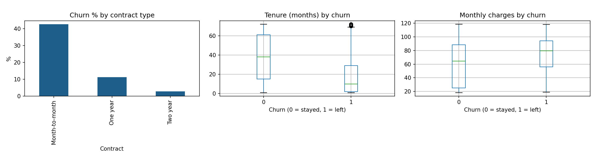
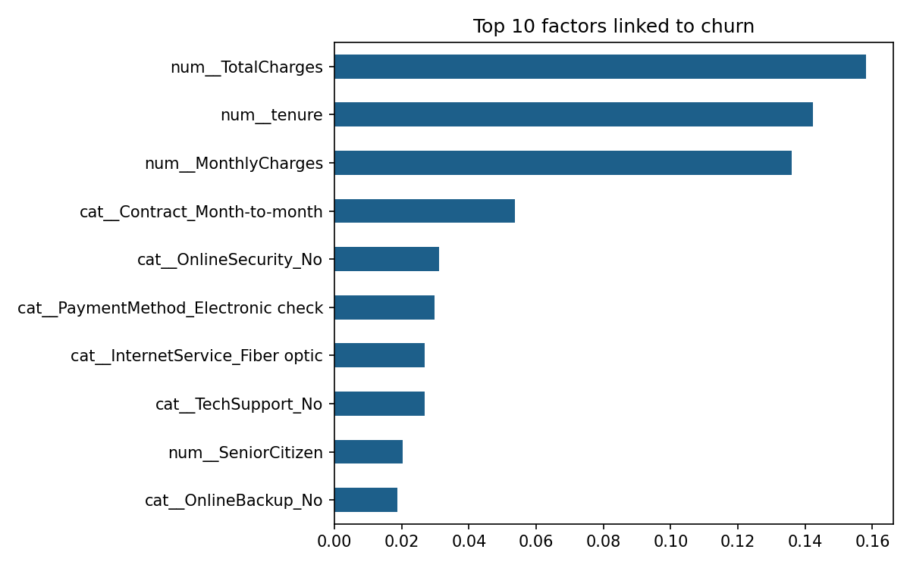

# Customer Churn Analysis & Prediction

**Why do telecom customers leave, and can we predict who will?**
An end-to-end data science project: data cleaning, exploratory analysis, and two machine learning models compared side by side.

  

## Key findings

- **Contract type matters most visibly.** Month-to-month customers churn at roughly 43%, versus about 11% for one-year and about 3% for two-year contracts.
- **New customers leave sooner.** The median tenure of customers who churned is about 10 months, compared with about 38 months for those who stayed.
- **Higher bills, higher churn.** Customers who left had a higher median monthly charge (about 80) than those who stayed (about 65).
- **Simple beat complex.** Logistic Regression outperformed Random Forest (ROC-AUC 0.836 vs 0.814).
- **The best model catches about 57% of churners** (recall 0.57), and 65% of its churn predictions are correct (precision 0.65).
- **Top factors linked to churn** (Random Forest): total charges, tenure and monthly charges.

## Results

| Model | ROC-AUC | Accuracy | Churn precision | Churn recall |
|---|---|---|---|---|
| Logistic Regression | **0.836** | **0.80** | **0.65** | **0.57** |
| Random Forest | 0.814 | 0.79 | 0.63 | 0.49 |

Evaluated on a held-out test set of 1,407 customers (20% of the data, stratified split).

## Charts





## Method

1. **Cleaning:** converted `TotalCharges` to numeric, dropped the few rows with blank values, removed the customer ID, encoded churn as 0/1.
2. **Exploration:** churn rate by contract type, tenure and monthly charges.
3. **Modelling:** scikit-learn pipeline with `StandardScaler` for numeric features and `OneHotEncoder` for categorical ones. 80/20 stratified train-test split.
4. **Evaluation:** ROC-AUC, precision and recall. Recall on the churn class is emphasised because missing a customer who is about to leave is the costly mistake.

## Dataset

[Telco Customer Churn](https://www.kaggle.com/datasets/blastchar/telco-customer-churn) (IBM sample dataset on Kaggle), about 7,000 customers and 20 features. Download it and save as `telco_churn.csv` in this folder.

## Run it yourself

```
pip install pandas matplotlib scikit-learn
python churn_analysis.py
```

Outputs: `churn_eda.png`, `feature_importance.png`, `results.txt`.

## Limitations and next steps

- Only about a quarter of customers churn, so the classes are imbalanced. Next: class weights or SMOTE to improve recall.
- Hyperparameters were not tuned. Next: grid search and gradient boosting.
- Turn the retention insights into an interactive Tableau or Power BI dashboard.
- Feature importance shows association, not cause.
